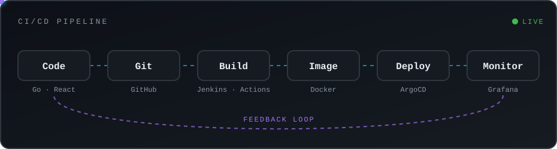

<!-- Header banner (animated wave) -->

<!-- Typing animation -->

  

<!-- Animated terminal (custom SVG) -->

---

## 👨‍💻 About Me

- 🎓 MCA student at **Parul University** (BCA from D Y Patil International University)
- 📍 Based in **Vadodara, India**
- 🎯 Preparing for **Cloud & DevOps Engineer** roles
- 🔭 Building **DevPortfolio Hub** — my portfolio + blog site with a full DevOps pipeline
- 🌱 Currently learning: **Golang, Terraform, Observability**
- 🐧 Daily driver: **Fedora Linux** (custom terminal setup)
- 📄 Wrote a seminar report on **Docker vs VPS** with my classmates
- ⚡ Fun fact: I run a small home server on an old **Poco X3** phone using Termux

---

## 🚀 Projects

| Project | What it is | Stack |
|---|---|---|
| 🌐 **DevPortfolio Hub** | Portfolio + blog site with full DevOps pipeline | React, Node.js, Go, PostgreSQL, Docker, Jenkins, Prometheus, Grafana |
| ☁️ **CloudCrest** | Cloud file storage app | Next.js, AWS S3, MongoDB |
| 📱 **Phone Server** | Home server running on an Android phone | Termux, SSH, File Browser, Cloudflare Tunnel |
| 📝 **Self-hosted LaTeX Editor** | Free personal Overleaf alternative for research papers | Docker, LaTeX |

---

## 🛠️ Tech Stack

### ☁️ DevOps & Cloud
          

### 📈 Monitoring
  

### 🖥️ Languages
      

### 🎨 Frontend & Backend
      

### 🗄️ Databases
     

### 🧰 Tools
    

---

## 🔄 My DevOps Flow

---

## 🤝 Connect With Me

  

 

